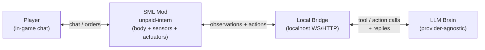

# unpaid-intern

> FICSIT's newest expendable employee. Eager. Legally a contractor. Will mine that node if you ask nicely (or not-so-nicely).

**unpaid-intern** is an open-source, LLM-powered companion for [Satisfactory](https://www.satisfactorygame.com/): a second pioneer with a body who joins your session, chats with you in-character, follows orders, and occasionally suggests a less daft plan.

**Status:** pre-alpha — repository holds the product spec and architecture only. No runnable mod yet.

## Sanctioned path (no piracy, no client cracks)

This project targets the community-established, Coffee Stain–endorsed modding stack:

- **[Satisfactory Mod Loader (SML)](https://ficsit.app/mod/SML)** and **[Satisfactory Mod Manager](https://smm.ficsit.app/)**
- Distribution via **[ficsit.app](https://ficsit.app)** (Satisfactory Mod Repository)
- Development against the official [Satisfactory Modding docs](https://docs.ficsit.app/satisfactory-modding/latest/) and the [Starter Project](https://docs.ficsit.app/satisfactory-modding/latest/Development/BeginnersGuide/StarterProject/ObtainStarterProject.html)

Coffee Stain does **not** ship official first-party mod tools, but has repeatedly said they love and heavily endorse the modding community ([wiki: Modding](https://satisfactory.wiki.gg/wiki/Modding); [CSS livestream Q&A, Feb 2026](https://archive.satisfactory.video/transcriptions/2026-02-17/q-a-any-native-support-for-any-of-the-circuitry-mod-features-planned/)). We will not redistribute game assets, crack DRM, or require a second Steam/Epic licence for a fake "second player." The intern is a **mod-spawned character** puppeted inside *your* session.

Target game / loader (as of research date 2026-10-30):

| Piece | Version | Source |
| --- | --- | --- |
| Satisfactory | **1.2** (CL ≥ 491125) | [SML 3.12.0 release notes](https://github.com/satisfactorymodding/SatisfactoryModLoader/releases/tag/v3.12.0) |
| SML | **3.12.0** | [ficsit.app/mod/SML](https://ficsit.app/mod/SML) |
| Engine (modding) | Custom **UE 5.6.1** (CSS + community) | [docs: Required Software](https://docs.ficsit.app/satisfactory-modding/latest/Development/BeginnersGuide/dependencies.html) |
| Audio | **Wwise 2025.1.6.x** | same docs |

## MVP (chosen)

The intern:

1. **Spawns** beside the host player
2. **Follows** the player
3. **Chats** in character via in-game chat (witty unpaid FICSIT contractor)
4. **Mines** resource nodes on command
5. **Builds miners** on nodes on command

Full acceptance criteria live in [`docs/SPEC.md`](docs/SPEC.md).

## Architecture overview

Three cooperating processes. The game stays authoritative; the LLM never touches disk or network except through the bridge's tool API.



| Layer | Responsibility |
| --- | --- |
| **SML mod** | Spawn/control the pioneer-like body; read nearby nodes & player pose; execute `follow`, `goto`, `mine`, `build_miner`, `say`; forward chat; never call cloud LLMs itself |
| **Local bridge** | Bind to `localhost` only by default; translate game events ↔ brain tool calls; enforce safety (confirm destructive actions, rate limits) |
| **LLM brain** | Persona + planning; provider-agnostic (OpenAI-compatible HTTP, Anthropic, local Ollama/LM Studio, etc.); emits structured tool calls only |

Precedents that prove the external-process pattern is normal in this community:

- **[Ficsit Remote Monitoring (FRM)](https://docs.ficsit.app/ficsitremotemonitoring/latest/)** — HTTP + WebSocket on localhost, including [`getChatMessages`](https://docs.ficsit.app/ficsitremotemonitoring/latest/json/json.html) and [`sendChatMessage`](https://docs.ficsit.app/ficsitremotemonitoring/latest/json/Write/sendChatMessage.html)
- **[FicsIt-Networks](https://docs.ficsit.app/ficsit-networks/latest/)** — in-game computers with Internet Card HTTP
- **[Spawn Mob With Websocket](https://ficsit.app/mod/9RvQQM81Sbcrht)** — spawn mobs driven by an external WebSocket client

## Repo layout (planned)

```
unpaid-intern/
├── README.md
├── LICENSE                 # MIT, 2026 Jack Reason
├── CONTRIBUTING.md
├── docs/
│   └── SPEC.md             # goals, MVP, API, milestones
├── mod/                    # SML plugin (C++/Blueprint) — TBD
├── bridge/                 # local WS/HTTP bridge — TBD
└── brain/                  # LLM agent runtime — TBD
```

## Multiplayer / dedicated servers

SML mods can run on Windows/Linux dedicated servers ([docs](https://docs.ficsit.app/satisfactory-modding/latest/ForUsers/DedicatedServerSetup.html)). For MVP we target **listen-host / single-player** first: the intern exists on the host where the mod + bridge + brain run. Joining clients would see the body if the mod is installed server-side; a vanilla client cannot join a modded dedicated server. Exact replication rules for a puppet pioneer are an open research item (see SPEC).

## Contributing

See [`CONTRIBUTING.md`](CONTRIBUTING.md). Please keep discussion constructive and stay on the sanctioned SML/ficsit.app path.

## Licence

[MIT](LICENSE) © 2026 Jack Reason.

Satisfactory is a trademark of Coffee Stain Studios. This project is unofficial and not affiliated with Coffee Stain or Krafton.
