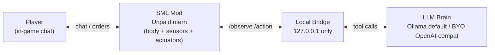

# unpaid-intern

> FICSIT's newest expendable employee. Eager. Legally a contractor. Will mine that node if you ask nicely (or not-so-nicely).

**unpaid-intern** is an open-source, LLM-powered companion for [Satisfactory](https://www.satisfactorygame.com/): a second pioneer with a body who joins your session, chats with you in-character, follows orders, and occasionally suggests a less daft plan.

**Status:** M1 scaffold — Python brain + mock bridge are runnable and tested. The SML mod is a **source skeleton only** (not compiled; needs the Starter Project on a Windows PC).

**Primary platform:** Windows 10/11.

## Sanctioned path (no piracy, no client cracks)

Community stack only: [SML](https://ficsit.app/mod/SML) + [Satisfactory Mod Manager](https://smm.ficsit.app/) + [ficsit.app](https://ficsit.app). Coffee Stain does not ship first-party mod tools but heavily endorses this ecosystem ([wiki](https://satisfactory.wiki.gg/wiki/Modding)). The intern is a **mod-spawned character** inside your session — not a second Steam/Epic client.

| Piece | Version |
| --- | --- |
| Satisfactory | **1.2** (CL ≥ 491125) |
| SML | **3.12.0** |
| Engine (modding) | Custom **UE 5.6.1** (CSS + community) |
| Audio | **Wwise 2025.1.6.x** |

## Architecture



## Quickstart (Windows PowerShell) — brain only

```powershell
cd path\to\unpaid-intern
.\scripts\Setup-Brain.ps1
.\scripts\Run-Tests.ps1
.\scripts\Run-Brain.ps1 -Mode mock
```

Environment (optional cloud):

```powershell
$env:INTERN_LLM_PROVIDER = "openai"   # default is ollama
$env:OPENAI_API_KEY = "sk-..."
$env:OPENAI_BASE_URL = "https://api.openai.com/v1"
$env:OPENAI_MODEL = "gpt-4o-mini"
```

Against a future live mod bridge: `.\scripts\Run-Brain.ps1 -Mode loop -Bridge http://127.0.0.1:8765`

## Repo layout

```
unpaid-intern/
├── Mod/UnpaidIntern/     # SML plugin skeleton (NOT compiled yet)
├── brain/                # Python 3.11+ brain + mock game + tests
├── scripts/*.ps1         # Windows setup / run / test
├── docs/                  # SPEC, ARCHITECTURE, REUSE, TEST-PLAN, ADRs
└── scripts/Run-Tests.ps1  # local ruff + pytest (GHA pending workflow OAuth scope)
```

## MVP scope

Spawn beside player → follow → chat in character → mine nodes → build miners (materials from **intern inventory**; command-only chat by default). Full acceptance criteria: [`docs/SPEC.md`](docs/SPEC.md). Architecture: [`docs/ARCHITECTURE.md`](docs/ARCHITECTURE.md) · Reuse: [`docs/REUSE.md`](docs/REUSE.md) · Tests: [`docs/TEST-PLAN.md`](docs/TEST-PLAN.md).

## Milestones

| ID | Goal | State |
| --- | --- | --- |
| M0 | Spec & licence on GitHub | Done |
| M1 | Scaffold: mod skeleton + brain/mock + tests | This tree (GHA CI pending) |
| M2 | Chat loop with live persona against local model | Next (needs compiled mod or richer mock) |
| M3 | Mine + build_miner end-to-end; ficsit.app prerelease | Later |

## Compiling the mod (Jack's Windows PC)

See [`Mod/UnpaidIntern/README.md`](Mod/UnpaidIntern/README.md). Short version: install VS 2022 + CSS UE 5.6.1 + Wwise → clone Starter Project for SML 3.12 → copy `Mod/UnpaidIntern` into `Mods/` → Generate VS project → Development Editor → Blueprint GameWorldModule + `/intern` chat command → Alpakit.

## Licence

[MIT](LICENSE) © 2026 Jack Reason. Unofficial; Satisfactory © Coffee Stain / Krafton.
