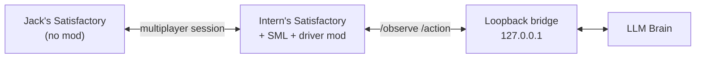

# unpaid-intern

> FICSIT's newest expendable employee. Eager. Legally a contractor. Will mine that node if you ask nicely (or not-so-nicely).

**unpaid-intern** is an open-source, LLM-powered companion for [Satisfactory](https://www.satisfactorygame.com/): a **real second pioneer** on a **second game licence** who joins your private session like a friend, chats in character, follows orders, and occasionally suggests a less daft plan.

**Status:** M1 scaffold — Python brain + mock bridge are runnable and tested. The SML mod is a **client-side driver skeleton** (not compiled; needs the Starter Project on a Windows PC). Architecture: [ADR-0006](docs/adr/0006-second-licence-client-driver.md) (supersedes spawned-pawn ADR-0002).

**Primary platform:** Windows 10/11.

## Sanctioned path (no piracy, no client cracks)

| Piece | Who installs it |
| --- | --- |
| Satisfactory (paid) | **Jack** and **intern** — two licences / accounts |
| [SML](https://ficsit.app/mod/SML) + [Mod Manager](https://smm.ficsit.app/) + UnpaidIntern | **Intern client only** (`RequiredOnRemote: false`) |
| Jack's client | **Vanilla** — no UnpaidIntern |

Coffee Stain endorses the community SML/ficsit.app ecosystem ([wiki](https://satisfactory.wiki.gg/wiki/Modding)). The driver injects **PlayerController / Enhanced Input / build-gun** on the intern's own pioneer — not screen scraping.

| Piece | Version |
| --- | --- |
| Satisfactory | **1.2** (CL ≥ 491125) |
| SML | **3.12.0** (intern) |
| Engine (modding) | Custom **UE 5.6.1** (CSS + community) |
| Audio | **Wwise 2025.1.6.x** |

## Architecture



## Quickstart (Windows PowerShell) — brain only

```powershell
cd path\to\unpaid-intern
.\scripts\Setup-Brain.ps1
.\scripts\Run-Tests.ps1
.\scripts\Run-Brain.ps1 -Mode mock
```

```powershell
$env:INTERN_LLM_PROVIDER = "openai"   # default is ollama
$env:OPENAI_API_KEY = "sk-..."
$env:OPENAI_BASE_URL = "https://api.openai.com/v1"
$env:OPENAI_MODEL = "gpt-4o-mini"
```

Against a future live driver bridge (on the **intern** machine): `.\scripts\Run-Brain.ps1 -Mode loop -Bridge http://127.0.0.1:8765`

## Repo layout

```
unpaid-intern/
├── Mod/UnpaidIntern/     # Client-side driver skeleton (NOT compiled yet)
├── brain/                # Python 3.11+ brain + mock game + tests
├── scripts/*.ps1         # Windows setup / run / test
├── docs/                 # SPEC, ARCHITECTURE, REUSE, TEST-PLAN, ADRs
└── .github/workflows/ci.yml
```

## MVP scope

Second licence joins Jack → follow (input drive) → chat in character → mine nodes → build miners via build gun (materials from **intern inventory**). Full acceptance: [`docs/SPEC.md`](docs/SPEC.md).

## Milestones

| ID | Goal | State |
| --- | --- | --- |
| M0 | Spec & licence on GitHub | Done |
| M1 | Scaffold: driver skeleton + brain/mock + tests | Done on main (+ GHA) |
| M2 | Join Jack + chat loop with live persona | Next (needs compiled mod + second licence) |
| M3 | Mine + build_miner end-to-end; ficsit.app prerelease | Later |

## Compiling the driver (Jack's Windows PC)

Full verified steps: [`docs/WINDOWS-SETUP.md`](docs/WINDOWS-SETUP.md). Short path: [`Mod/UnpaidIntern/README.md`](Mod/UnpaidIntern/README.md). VS 2022 + CSS UE 5.6.1 + Wwise → Starter Project tag `v3.12.0` → copy `Mod/UnpaidIntern` → Alpakit **Windows client** (intern only). Confirm `RequiredOnRemote: false` in the uplugin.

## Licence

[MIT](LICENSE) © 2026 Jack Reason. Unofficial; Satisfactory © Coffee Stain / Krafton.

## Storefront terms (read before you run this)

Driving a pioneer with a client-side input/automation mod can conflict with **Steam** and **Epic** automation / bot clauses. Coffee Stain endorses the SML/ficsit.app ecosystem for mods; that is **not** a written exemption for bots.

**Do this only if you have read your own storefront terms and accept the residual risk.** Owner mitigations (see [ADR-0006](docs/adr/0006-second-licence-client-driver.md) Risk acceptance, accepted 30 Oct 2026 Australia/Sydney):

- Second **paid** Satisfactory licence on a separate account (no credential sharing).
- **Private** sessions only (friends / private / IP listen — not public matchmaking or rewards).
- Driver + SML on the **intern client only**; Jack stays vanilla.

Windows compile + dual-client setup: [`docs/WINDOWS-SETUP.md`](docs/WINDOWS-SETUP.md).
