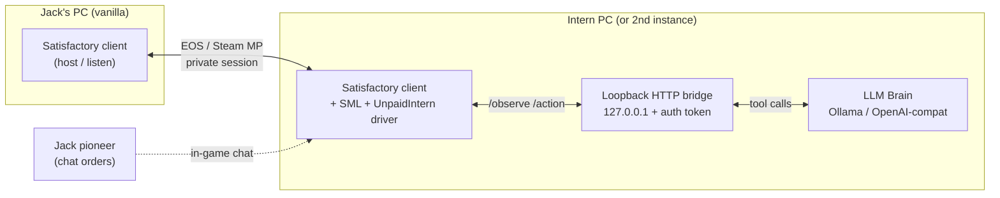
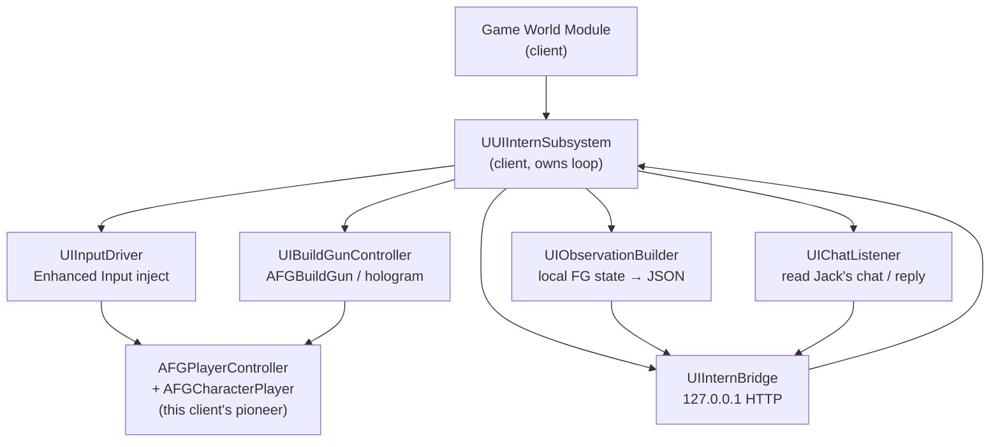
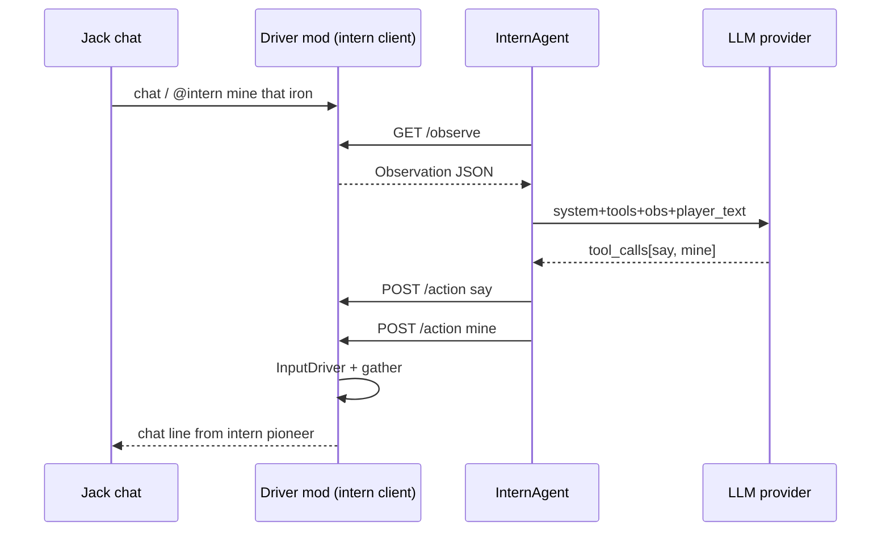
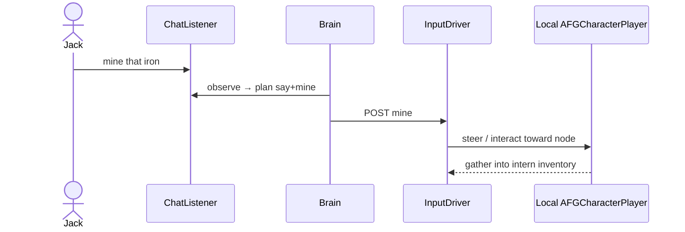
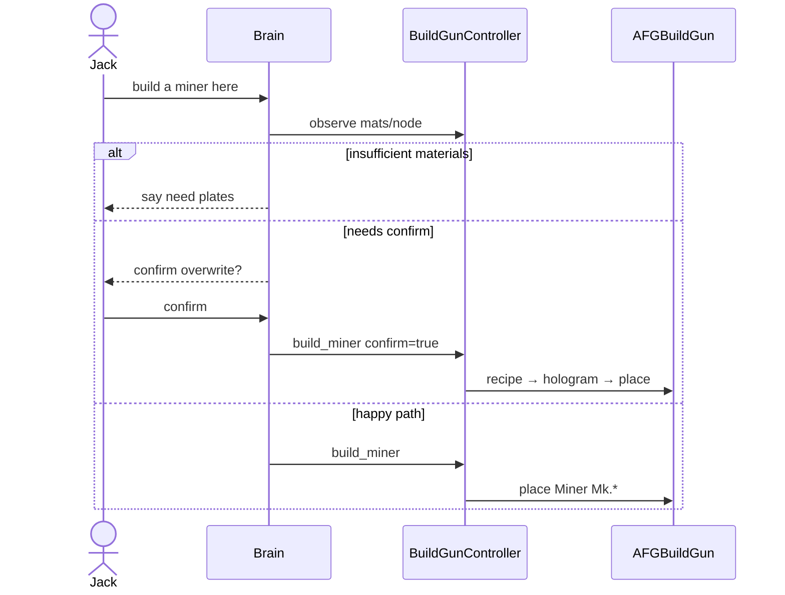

# unpaid-intern — Architecture

**Last updated:** 2026-10-30 (Australia/Sydney)  
**Status:** living design — **ADR-0006 second-licence driver**  
**Companion docs:** [SPEC.md](SPEC.md) · [REUSE.md](REUSE.md) · [TEST-PLAN.md](TEST-PLAN.md) · [adr/](adr/)

---

## 1. Goals of this design

1. Keep the **LLM outside the game process** (crash isolation, hot-swap models, no UE plugin for every provider).
2. Stay on the **SML / ficsit.app** path — client-side driver only on the intern's instance (`RequiredOnRemote: false`).
3. Make the intern a **real co-op pioneer**: second paid licence joins Jack's session like a friend.
4. Drive that pioneer via **normal PlayerController / Enhanced Input / build-gun paths** (not screen scraping, not OS SendInput).
5. Prefer **reuse over reinventing** where licences and maintenance allow (see REUSE.md).

---

## 2. Process & network boundaries

Four logical pieces. Jack's game stays **vanilla** (no UnpaidIntern, optionally no SML).



| Boundary | Who owns it | Failure mode if down |
| --- | --- | --- |
| Jack ↔ Intern (game MP) | Vanilla multiplayer | Session drop; no special recovery |
| Intern game ↔ Bridge | Driver mod (UE, intern client) | Brain sees connect errors; intern holds |
| Bridge ↔ Brain | Python `BridgeClient` | Actions stop; local `/intern hold|cancel` still work |
| Brain ↔ LLM | Provider adapters | Timeout → canned chat line |

**Non-goals at this boundary:** embedding FIN Lua as the brain; LLM inside the `.pak`; binding the bridge to `0.0.0.0` by default; requiring any mod on Jack's client.

---

## 3. Driver mod internals (intern client only)



### 3.1 `UUIInternSubsystem` (intern **client**)

- Does **not** spawn a pawn — the local pioneer **is** the intern.
- Owns the action state machine and rate limits.
- Starts the loopback bridge with a per-session auth token (FRM-style; ADR-0003).
- Only creates itself on a game client that has this mod loaded (Jack's vanilla client never loads it).

### 3.2 `UIInputDriver`

- Injects move / look / jump / crouch / interact through **Enhanced Input** mapping contexts bound on `AFGPlayerController` (same actions a human would fire).
- Implements high-level intents from the brain: `follow` (steer toward Jack's pawn), `goto`, `hold` (zero move), approach node for `mine`.
- **Not** screen scraping; **not** OS-level keybd_event.

### 3.3 `UIBuildGunController`

- Drives `AFGBuildGun` states: select miner recipe → aim hologram at node → multi-step confirm.
- Consumes materials from the **intern pioneer's inventory** (SPEC D1).
- `confirm=true` required for overwrite (safety).

### 3.4 `UIObservationBuilder`

- Emits SPEC §4.2 JSON from local world queries (self pose/inventory, Jack's replicated pawn pose, nearby `AFGResourceNode`s, chat inbox).
- `session.mode` reflects join role (`client` when intern joined Jack; `listen_host` only if intern hosts — not the MVP topology).

### 3.5 `UIChatListener`

- Default **command-only**: lines addressed to the intern / `/intern …` → brain as `player_text`.
- Toggle **always-listen** for Jack's chat (ignore other players unless configured).
- Replies via normal / SML scripted chat **as the intern pioneer** (appears like a friend typing).
- Local overrides that **never wait on the LLM**: `hold`, `cancel`, `mute`.

### 3.6 Bridge server

- Bind **`127.0.0.1` only** by default (on the machine running the intern client).
- Endpoints: `GET /health`, `GET /observe`, `POST /action`.
- Auth: `Authorization: Bearer <token>`.
- Business errors: HTTP 200 + `{ "ok": false, "error": "…" }`.

### 3.7 Client-only packaging

```json
"RequiredOnRemote": false
```

See [ADR-0006](adr/0006-second-licence-client-driver.md) and [SML ReleaseMod Special Fields](https://docs.ficsit.app/satisfactory-modding/latest/Development/BeginnersGuide/ReleaseMod.html). Jack's host does not need UnpaidIntern (or, for a pure client-only mod, SML on the host — per SML 3.8 client-side-only note).

---

## 4. Brain internals

Unchanged from ADR-0001 / ADR-0005. Planner: `observe → provider.complete(tools) → apply_tool_calls`.



---

## 5. Sequence: "mine that node"



---

## 6. Sequence: "build miner"



---

## 7. Multiplayer topology

| Mode | MVP stance |
| --- | --- |
| Jack host (listen) + intern client | **Primary** |
| Dedicated server + Jack + intern | Later — both join DS; driver still only on intern client |
| Intern as host | Supported accidentally; not the intended UX |
| Brain on Jack's PC talking to remote intern | Out of scope — bridge stays loopback on intern machine |

Replication: vanilla. The driver never needs RCOs on Jack's side.

---

## 8. Dual-instance / hardware

See ADR-0006 §D. Summary:

- **Preferred one-PC:** Steam (Jack) + Epic (intern), or SML Quick Launch `-multiplayer` for dry-runs.
- **Preferred if heavy:** second PC or cloud GPU for intern client + brain.
- Intern launch: `-windowed -ResX=1280 -ResY=720 -nosplash` (and `-noaudio` if desired). Not `-nullrhi` for a playable pioneer.

---

## 9. Versioning & compatibility

| Pin | Value |
| --- | --- |
| Game | Satisfactory 1.2, CL ≥ 491125 |
| SML | 3.12.x on **intern client** (`^3.12.0`) |
| Engine | CSS UE 5.6.1 + Wwise 2025.1.6.x |
| Brain | Python ≥ 3.11; `bridge_protocol` in `/health` |
| uplugin | `RequiredOnRemote: false` |

---

## 10. Failure modes

| Failure | Detection | Mitigation |
| --- | --- | --- |
| Brain down | `/health` / TCP | Hold; canned radio-static chat |
| LLM timeout | Provider deadline | Canned `say`; no speculative builds |
| Input inject fails | Action result | `ok:false`; escalate logs |
| Nav / follow stuck | Timer | Stop + say; optional teleport-assist later |
| Jack session drop | EOS/Steam | Standard reconnect |
| Auth mismatch | HTTP 401 | Refuse; log once |
| Schema skew | `bridge_protocol` | Brain refuses actions |

---

## 11. ADR index

| ADR | Title |
| --- | --- |
| [0001](adr/0001-llm-outside-game.md) | LLM runs outside the game process |
| [0002](adr/0002-intern-pawn-ai.md) | ~~Simplified pawn + AIController~~ **Superseded by 0006** |
| [0003](adr/0003-bridge-http-loopback.md) | Loopback HTTP + bearer token |
| [0004](adr/0004-materials-from-intern.md) | Build materials from intern inventory |
| [0005](adr/0005-tool-calling-not-codegen.md) | Constrained tool calling |
| [0006](adr/0006-second-licence-client-driver.md) | **Second licence, client-side driver mod** |

---

## 12. Decisions still needing Jack

1. **ToS residual risk** — accept SSA/Epic automation language for a private-session OSS companion? (ADR-0006 verdict)
2. **Hardware** — Steam+Epic one PC vs second PC / cloud GPU for intern?
3. **Account ownership** — which launcher/account is Jack vs intern; no credential sharing.
4. **ficsit.app copy** — private-session / second-licence requirements on the mod page.
5. Soft-depend on FRM for extra sensors? (still open)
