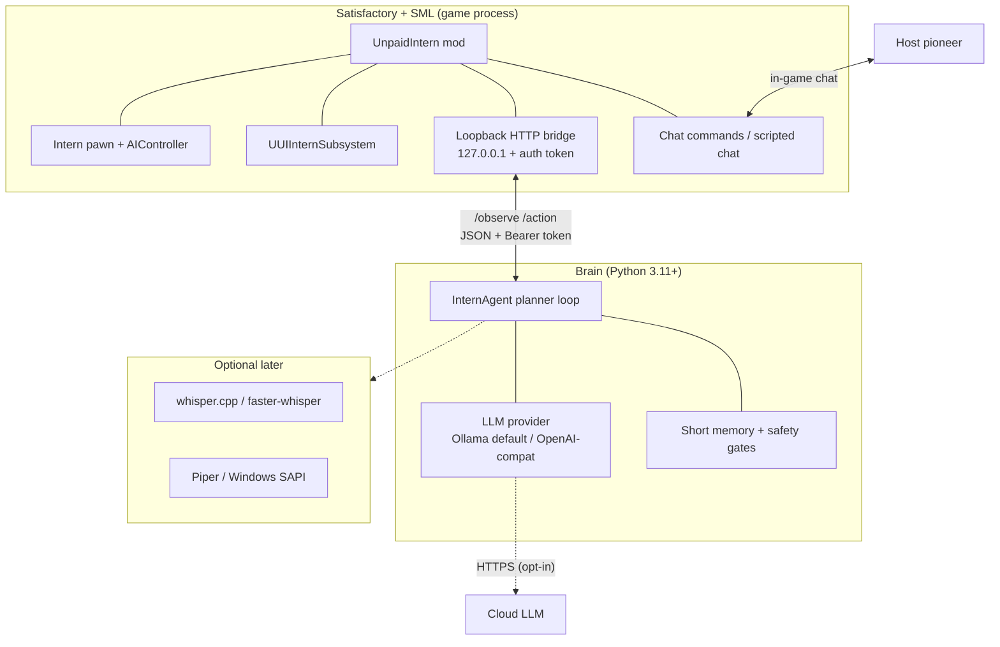
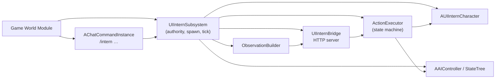
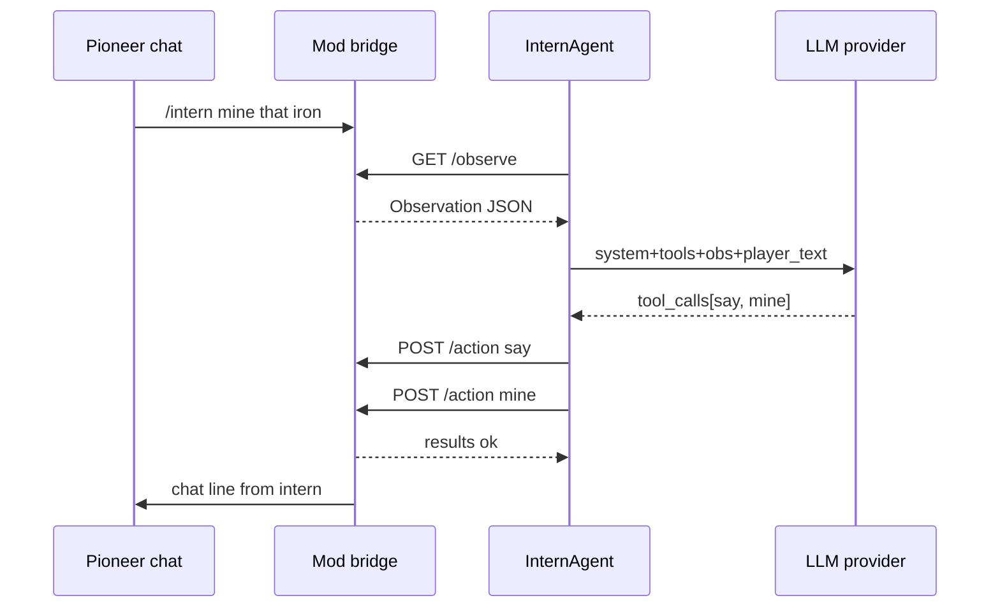
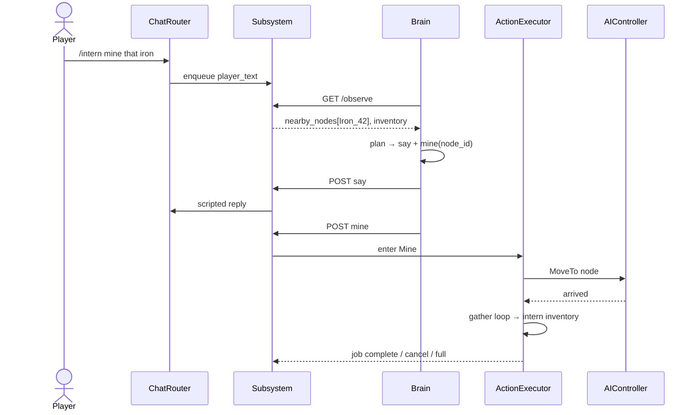
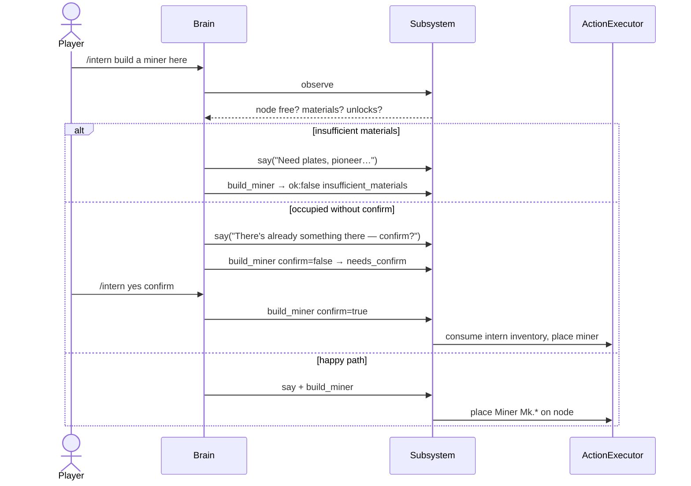

# unpaid-intern — Architecture

**Last updated:** 2026-10-30 (Australia/Sydney)  
**Status:** living design (M1 scaffold + M-architecture)  
**Companion docs:** [SPEC.md](SPEC.md) · [REUSE.md](REUSE.md) · [TEST-PLAN.md](TEST-PLAN.md) · [adr/](adr/)

---

## 1. Goals of this design

1. Keep the **LLM outside the game process** (crash isolation, hot-swap models, no UE plugin for every provider).
2. Stay on the **SML / ficsit.app** path — reuse proven patterns (chat commands, mod subsystems, RCOs, FRM-style localhost HTTP+token).
3. Make the intern feel like a **co-op teammate**: body + AIController + chat + tool-shaped actions.
4. Prefer **reuse over reinventing** where licences and maintenance allow (see REUSE.md).

---

## 2. Process boundaries

Three processes (MVP). The game never loads Python; the brain never links Unreal.

| Boundary | Who owns it | Failure mode if down |
| --- | --- | --- |
| Game ↔ Bridge | Mod (UE) | Brain sees connect errors; intern holds / canned radio-static chat |
| Bridge ↔ Brain | Python `BridgeClient` | Actions stop; `/intern hold|cancel` still work in-mod |
| Brain ↔ LLM | Provider adapters | Timeout → canned line; no tool calls applied |

**Non-goals at this boundary:** embedding FIN Lua computers as the brain; running the LLM inside the `.pak`; binding the bridge to `0.0.0.0` by default.

---

## 3. Mod internals

### 3.1 `UUIInternSubsystem` (server / listen-host authority)

- Spawns / despawns the intern pawn.
- Owns the action state machine and rate limits.
- Builds observations each tick (or on demand).
- Starts the loopback bridge with a per-session auth token (FRM-style; see ADR-0003).
- Replicated summary state for clients (nameplate, job string); **execution is server-only**.

### 3.2 Intern pawn + AIController

- Prefer a **simplified humanoid** (player-like mesh + nameplate) under a custom `AAIController` rather than a full second `AFGPlayerController` (see ADR-0002).
- Movement: UE path following against the world's navigation. Satisfactory creatures already move; pioneer-grade nav in heavily built factories is a known risk (fallback: teleport-to-host after stuck timer — SPEC AC-2.3).
- Animation MVP: walk / idle / mine montage stubs; build gun FX can wait.

### 3.3 Action executor (state machine)

States: `Idle → Follow | Goto | Mine | BuildMiner → Idle`, plus `Hold` and `Cancel` from any busy state.

| Action | Executor responsibility |
| --- | --- |
| `follow` | AIC MoveTo host actor, distance band |
| `hold` / `cancel` | Stop movement, clear job |
| `goto` | MoveToLocation |
| `mine` | Path to node, play gather loop, add items to **intern inventory** |
| `build_miner` | Validate node + materials + unlocks; place miner via FG build APIs or hologram-equivalent; `confirm` for overwrite |
| `say` | Scripted chat as intern display name |

### 3.4 Observation builder

Emits the JSON in SPEC §4.2. Align class names with Docs.json / FRM conventions (`Desc_OreIron_C`, etc.) so recipe parsers and debugging stay coherent.

### 3.5 Chat router

- Default **command-only**: `/intern …` → brain as `player_text`.
- Toggle **always-listen**: all host chat forwarded (still ignore other players unless config says otherwise).
- Local overrides that **never wait on the LLM**: `hold`, `cancel`, `mute`, `despawn`.

### 3.6 Bridge server

- Bind **`127.0.0.1` only** by default.
- Endpoints: `GET /health`, `GET /observe`, `POST /action`.
- Auth: `Authorization: Bearer <token>` (token in mod config / log once at start).
- Business errors return HTTP 200 + `{ "ok": false, "error": "…" }` (brain-friendly; matches current mock).

---

## 4. Brain internals

### 4.1 Planner loop

`observe → (optional drain chat) → provider.complete(tools=TOOL_SPECS) → apply_tool_calls → results`.

Implemented today in `brain/unpaid_intern/agent.py`. Heartbeat ticks without new chat are allowed (persona treats them as heartbeat).

### 4.2 Tool schema

Canonical OpenAI-style tools in `schema.TOOL_SPECS`. Pydantic models validate observations and action calls for contract tests.

### 4.3 Memory (MVP → later)

| Layer | MVP | Later |
| --- | --- | --- |
| Working | Last observation + last N tool results in prompt | Sliding window summariser |
| Episodic | None | "We already wired that node" notes |
| Semantic | Persona + safety rules in system prompt | Docs.json recipe snippets on demand |

Lessons from Minecraft agents (Mindcraft / Voyager / Mineflayer): **constrain tools**, prefer structured tool calls over free-form code gen, keep a skill library for repeated chores, and always ground in fresh observation JSON (do not invent state).

### 4.4 Safety / confirmation

- Destructive / overwrite paths require `confirm=true` after a warning `say`.
- Rate limits in the mod (not only the brain).
- No host filesystem tools; bridge is the only I/O.
- Jailbreak refusals stay in-character ("HR says I can't discuss that, pioneer").

---

## 5. Sequence: "mine that node"

Acceptance mapped: SPEC AC-4.*.

---

## 6. Sequence: "build miner"

Materials: **intern inventory** (SPEC D1). Dev `bFreePlacement` never ships enabled.

---

## 7. Multiplayer & dedicated server

| Mode | MVP stance |
| --- | --- |
| Single-player | Supported |
| Listen-host | Supported (host runs bridge + brain) |
| Dedicated server | **Deferred** (SPEC D5). Design implication: all mutation on server subsystem; clients see replicated pawn + chat only |
| Join-as-client with brain | Out of scope — brain talks to host/server bridge only |

Replication rules (from SML multiplayer docs):

- Client → server intents: **Remote Call Object** on the player controller.
- Server → clients / multicast: **replicated mod subsystem** (never multicast from RCO).
- Intern pawn: server-spawned, replicated; AI tick server-side.

---

## 8. Versioning & compatibility

| Pin | Value |
| --- | --- |
| Game | Satisfactory 1.2, CL ≥ 491125 |
| SML | 3.12.x (`^3.12.0` on ficsit.app) |
| Engine | CSS UE 5.6.1 + Wwise 2025.1.6.x |
| Brain | Python ≥ 3.11; schema version field in `/health` |

Strategy:

1. Ship `session.game_version` / `session.sml` in observations; brain warns on mismatch.
2. Additive JSON fields only within a major bridge version; breaking changes bump `bridge_protocol` integer.
3. Recompile mod for each SML major (community expectation after UE bumps).

---

## 9. Failure modes

| Failure | Detection | Mitigation |
| --- | --- | --- |
| Brain process down | `/health` fail / TCP error | Intern holds; chat: radio-static canned line; commands `hold/cancel` still local |
| LLM timeout / empty | Provider deadline | Canned `say`; no speculative builds |
| Invalid tool JSON | Pydantic / schema | Reject action; ask model to retry once |
| Nav stuck | Timer in Follow/Goto | Teleport near host (MVP) |
| Auth token mismatch | HTTP 401 | Refuse; log once |
| Bridge bound off-loopback | Config guard | Hard-deny unless user opts in + token |
| Mod/brain schema skew | `bridge_protocol` | Brain refuses to apply actions; tell player to update |

---

## 10. ADR index

| ADR | Title |
| --- | --- |
| [0001](adr/0001-llm-outside-game.md) | LLM runs outside the game process |
| [0002](adr/0002-intern-pawn-ai.md) | Simplified pawn + AIController (not a second player controller) |
| [0003](adr/0003-bridge-http-loopback.md) | Loopback HTTP + bearer token (not raw dependency on FRM) |
| [0004](adr/0004-materials-from-intern.md) | Build materials from intern inventory |
| [0005](adr/0005-tool-calling-not-codegen.md) | Constrained tool calling (not Voyager-style code gen) |

---

## 11. Decisions still needing Jack

See the closing section of the architect report / open questions in SPEC. Highest leverage: pawn fidelity vs ship-date, whether to **soft-depend on FRM** for extra sensors, and dedicated-server timeline.
