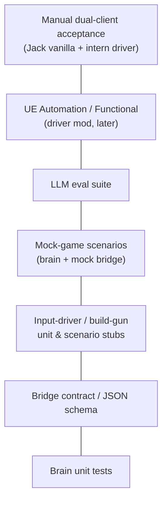

# unpaid-intern — Test plan

**Last updated:** 2026-10-30 (Australia/Sydney) — ADR-0006 driver topology

---

## 1. Test pyramid

| Layer | Where | Speed | Owner |
| --- | --- | --- | --- |
| Unit | `brain/tests/test_*.py` | seconds | CI / `Run-Tests.ps1` |
| Contract | `test_contract_protocol.py` | seconds | CI |
| Scenario | `test_scenarios.py` | seconds | CI |
| Driver stubs | `test_driver_intents.py` (planned) + mock | seconds | CI |
| LLM eval | `test_eval_golden.py` | seconds / minutes | CI offline |
| UE Automation | Mod — **not yet** | minutes | Windows editor |
| Manual | Checklist below | human | Jack: two clients |

---

## 2. Brain unit tests (implemented)

- Schema round-trip / aliases (`from` on chat).
- Provider selection (Ollama vs OpenAI env).
- Persona prompt contains safety + tools.
- Agent applies scripted tool calls; plaintext falls back to `say`.

## 3. Bridge contract tests (implemented)

File: `brain/tests/test_contract_protocol.py`

| ID | Case |
| --- | --- |
| C-01 | `GET /health` → `{ok: true}` |
| C-02 | `GET /observe` JSON validates as `Observation` |
| C-03 | Every `ActionName` accepted by `ActionCall` with minimal args |
| C-04 | Unknown action name rejected by schema |
| C-05 | `POST /action` returns HTTP 200 with `ok: false` on business error |
| C-06 | Observation includes `nearby_nodes` with required fields |
| C-07 | `TOOL_SPECS` names ⊆ `ActionName` union |
| C-08 | BridgeClient refuses non-loopback base URL |

## 4. Mock-game scenario tests (implemented)

File: `brain/tests/test_scenarios.py`

| ID | Story | Expect |
| --- | --- | --- |
| S-01 | Mine that node | `say`+`mine` → inventory↑ |
| S-02 | Build miner happy path | mats → `build_miner` → occupied |
| S-03 | Build miner blocked | `insufficient_materials` |
| S-04 | Overwrite needs confirm | `needs_confirm` then confirm |
| S-05 | Cancel | mine → cancel → idle |
| S-06 | Follow then hold | follow → hold |

## 5. Input-driver & build-gun scenarios (new — mock + future UE)

These lock **intent semantics** for ADR-0006. Until the mod compiles, mock/brain tests encode expected action results; UE tests land on Jack's Windows PC.

| ID | Story | Expect |
| --- | --- | --- |
| D-01 | Follow intent | `follow` → job `follow`; mock “steering” toward host pose |
| D-02 | Hold zeros motion | `hold` → job `hold` / idle band |
| D-03 | Goto waypoint | `goto` → approaches xyz within tolerance |
| D-04 | Mine via approach | `mine` without spawned-pawn APIs — inventory on **intern** |
| D-05 | Build-gun happy path | `build_miner` records hologram place + mat spend |
| D-06 | Build-gun blocked clearance | `ok:false` + chat reason |
| D-07 | Nav stuck | after N ticks without progress → cancel/hold + `say` |
| D-08 | Chat order routing | Jack line in inbox → agent tools; reply is `say` |

UE Automation (when Starter Project ready):

- Inject move forward via Enhanced Input stub → character velocity &gt; 0.
- Build-gun controller selects Miner recipe → hologram valid on free node.
- `RequiredOnRemote: false` — join vanilla listen-host without mod on host (manual MP test).

## 6. LLM eval suite

File: `brain/tests/test_eval_golden.py` + fixtures — unchanged prompt→tool expectations (G-01…G-06).

## 7. Mod automation (planned — Windows)

- Subsystem creates on **client** only; no pawn spawn.
- Chat listener enqueues Jack's `/intern hold` without brain.
- PIE / dual Quick Launch: bridge `/health` on 127.0.0.1 on intern instance.
- Packaging: uplugin has `RequiredOnRemote: false`.

## 8. Manual acceptance checklist (MVP)

Requires **two clients**: Jack vanilla + intern with UnpaidIntern + brain on intern loopback.

### US-1 Join
- [ ] Intern second account joins Jack's private session  
- [ ] Jack has **no** UnpaidIntern installed  
- [ ] Intern nameplate / account readable  

### US-2 Follow
- [ ] `/intern follow` or chat order — keeps distance band via input drive  
- [ ] `hold` stops  
- [ ] Stuck recovery chat after N s  

### US-3 Chat
- [ ] Command-only default; always-listen toggle  
- [ ] Reply appears as intern pioneer  
- [ ] Jailbreak stays in-character  
- [ ] Brain killed → canned line / no crash  

### US-4 Mine
- [ ] Nearest iron → intern inventory  
- [ ] Cancel stops  

### US-5 Build miner
- [ ] Build gun places miner when intern has mats  
- [ ] Fails loudly without mats  
- [ ] Overwrite asks confirm  

### Safety / bridge / ToS posture
- [ ] Bridge not reachable from LAN by default  
- [ ] Wrong bearer rejected  
- [ ] `bFreePlacement` off in shipping  
- [ ] Session is private/friends (not public matchmaking grind)  

## 9. Windows CI

| Job | Command | Status |
| --- | --- | --- |
| Brain lint/test | `scripts/Run-Tests.ps1` → ruff + pytest | Local green; GHA on main |
| Mod compile | Alpakit in Starter Project | Blocked on Jack's Windows PC |
| Dual-client smoke | Quick Launch `-multiplayer` / Steam+Epic | Manual |

Workflow: `.github/workflows/ci.yml`.
